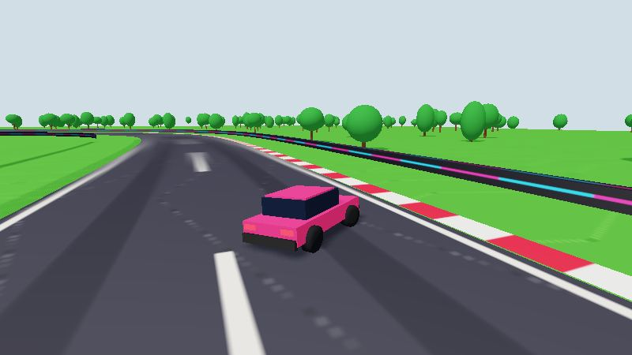
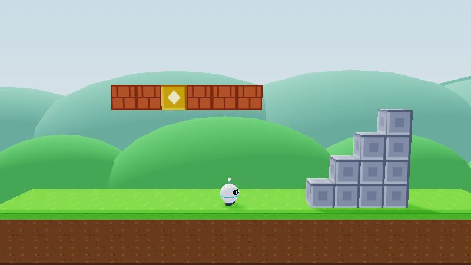
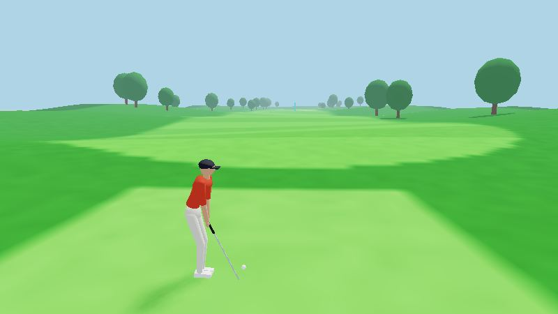
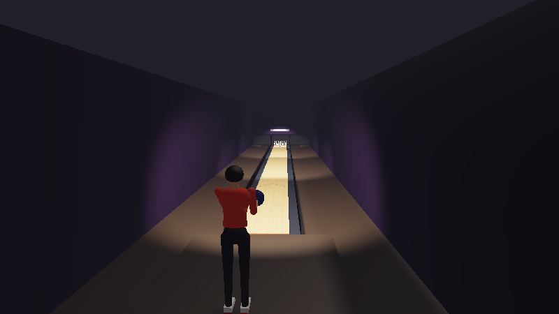
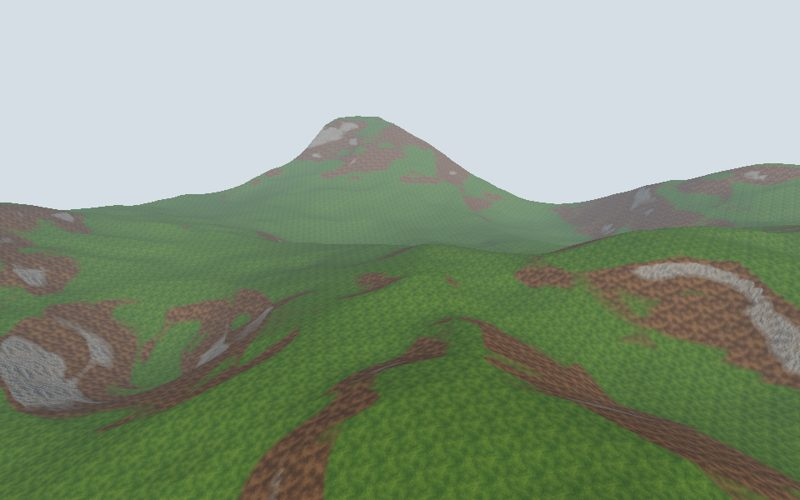

# Omega Games

Small games (and a demo) made with the [Omega game engine](https://github.com/tugapse/omega-game-engine),
each one built to try the engine out on something real. All the cars, characters, tracks,
sounds and music are our own, made in code.

**[▶ Play them all](https://tugapse.github.io/omega-games/)** · in the browser, on phones too

<table>
<tr>
<td width="33%" valign="top">
<a href="src/drift/"></a>
<h3><a href="src/drift/">Omega Drift</a></h3>
Round toy cars and drifts that charge a turbo: 6 tracks, cups, a ghost.<br>
<a href="https://tugapse.github.io/omega-games/drift/">▶ Play</a>
</td>
<td width="33%" valign="top">
<a href="src/platformer/"></a>
<h3><a href="src/platformer/">Omega Run</a></h3>
A platformer: 9 levels in 3 worlds, moving platforms, bosses, saved progress.<br>
<a href="https://tugapse.github.io/omega-games/platformer/">▶ Play</a>
</td>
<td width="33%" valign="top">
<a href="src/golf/"></a>
<h3><a href="src/golf/">Omega Golf</a></h3>
Nine holes of Vale Omega with its own ball physics, a drag-to-swing and the computer.<br>
<a href="https://tugapse.github.io/omega-games/golf/">▶ Play</a>
</td>
</tr>
<tr>
<td valign="top">
<a href="src/bowling/"></a>
<h3><a href="src/bowling/">Omega Bowling</a></h3>
Rapier physics, swipe to throw, obstacle lanes, a computer to beat and replays.<br>
<a href="https://tugapse.github.io/omega-games/bowling/">▶ Play</a>
</td>
<td valign="top">
<a href="src/terrain/"></a>
<h3><a href="src/terrain/">Omega Terreno</a></h3>
The engine's terrain: generate, sculpt, ramp, stamp, erode, paint, flood, grow and walk it.<br>
<a href="https://tugapse.github.io/omega-games/terrain/">▶ Play</a>
</td>
<td valign="top"></td>
</tr>
</table>

## What each one tries in the engine

| | Physics | Animation | Audio | Terrain | Saved in the browser | Tests |
| --- | --- | --- | --- | --- | --- | --- |
| **Drift** | its own (bicycle model) | | synthesised engine, tyres, music | | medals, cups, cars | 113 |
| **Run** | its own (tile grid) | Bit's skeleton, Animator | chiptunes per world | | levels, coins, scores | 74 |
| **Golf** | its own (ball flight) | golfer's skeleton | Web Audio | its own height grid | records | 45 |
| **Bowling** | Rapier | bowler's skeleton | SequencerClock music | | | 53 |
| **Terreno** | Rapier heightfields | | | `TerrainBehaviour` | the whole terrain | 26 |

## How it is laid out

```text
omega-games/
├── src/
│   ├── bowling/       each game: index.html, README.md, tsconfig.json,
│   ├── drift/           src/ (main.ts, modules and their tests), media/ (README pictures)
│   ├── golf/
│   ├── platformer/
│   └── terrain/
├── index.html         the games page
├── shots/             the games page's pictures
├── scripts/           build-games.mjs (esbuild) · engine.mjs (where the engine is)
└── docs/              the built site, served by GitHub Pages from develop
```

## Working on it

The games import `omega-game-engine` from the engine's source. Until the engine is on npm,
the build and the tests point that name to the
[omega-engine](https://github.com/tugapse/omega-game-engine) repository checked out next to
this one (`../omega-engine`), or to the folder in `OMEGA_ENGINE`.

| Command | |
| --- | --- |
| `npm install` | |
| `npm test` | every game's tests (vitest, in Node) |
| `npm run check` | type check every game |
| `npm run build` | bundles every game into `docs/<game>/` |
| `npm run build -- drift` | one game |
| `cd docs && python3 -m http.server 8790` | play them at http://localhost:8790 |

GitHub Pages serves `docs/` from `develop`, so the bundles are committed with the source.
Git-flow: work on a branch from `develop` and merge it back with `--no-ff`.
