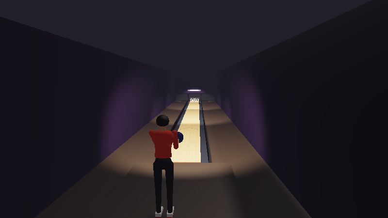
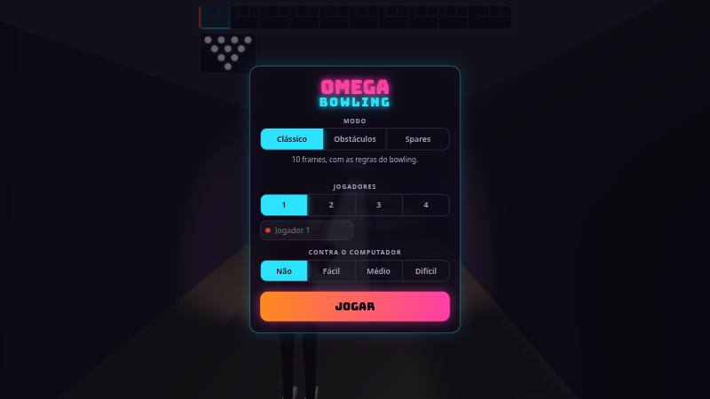
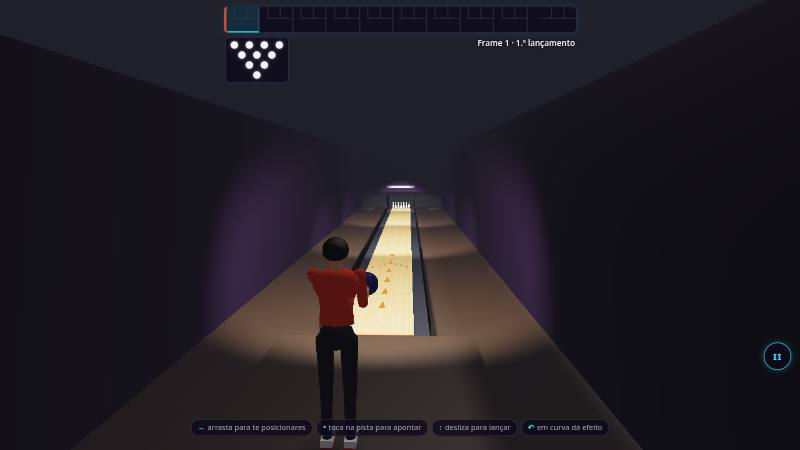
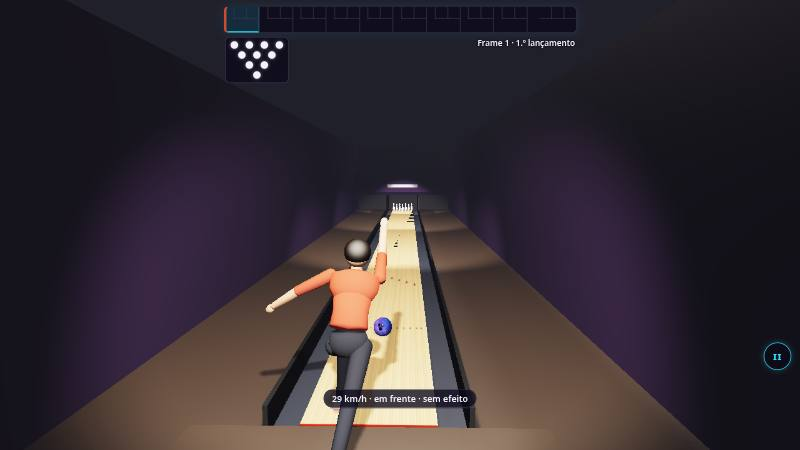
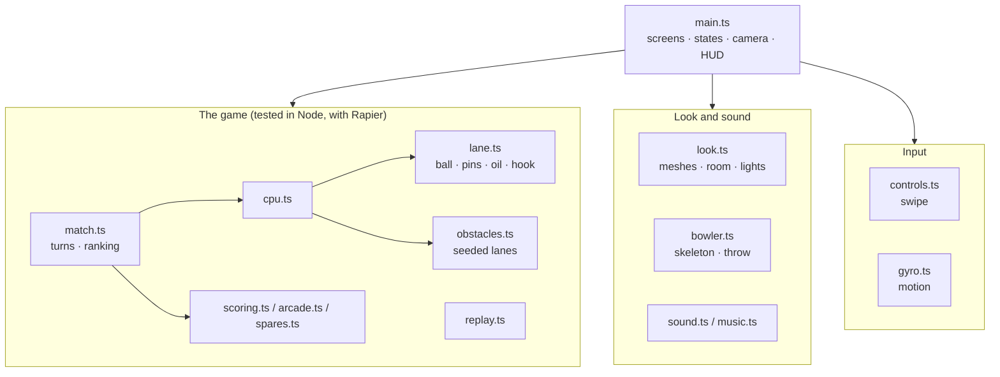

# Omega Bowling

**Swipe to bowl: a hook into the pocket, obstacle lanes, a computer to beat and strike replays.**
A bowling game made with the Omega engine and its physics module (Rapier): the ball, the pins and
the oil on the lane are all simulated.

**[▶ Play it](https://tugapse.github.io/omega-games/bowling/)** · swipe on a phone, or the keyboard



| | |
| --- | --- |
| **Games** | Clássico (ten frames), Obstáculos (moving lanes, levels that multiply points), Spares (ten leaves to clear) |
| **Players** | one to four, and the computer (easy, medium, hard) |
| **Physics** | Rapier: the ball's friction on the oil and the dry back end makes the hook |
| **Bowler** | a skeleton with a four-step approach, slide, release and follow-through, keyed in code |
| **Audio** | rolling, pin clacks and a lounge bossa, all synthesised; no sound files |
| **Tests** | 53 |

<table>
<tr>
<td width="33%"><br>Pick the game, the players and the computer</td>
<td width="33%"><br>Line up and aim</td>
<td width="33%"><br>The release</td>
</tr>
</table>

## Playing

**Drag sideways** to move along the line, **swipe up** to bowl; a **curved swipe** gives spin,
and the ball hooks once it reaches the dry back end of the lane.

| | Touch | Keyboard |
| --- | --- | --- |
| Move along the line | drag sideways | ← → |
| Aim | | A / D |
| Bowl | swipe up (curved for a hook) | space (straight), Q / E (left or right hook) |
| Pause | ❚❚ | Esc or P |
| Start screen | tap | M switches the game, 1–4 pick the players, Enter plays |

### The games

| Game | |
| --- | --- |
| **Clássico** | ten frames with the rules of bowling: strikes, spares, the tenth frame |
| **Obstáculos** | ten rounds of up to two balls on lanes with posts, bumpers, sliders, a spinner and wind; your level rises with the pins down (12, 24, 36… for levels 2 to 8) and multiplies your points (×1, ×1.5, ×2…) |
| **Spares** | ten leaves, from the 5 pin to the 7-10, one ball each; a clear scores its stars × 10 |

The computer bowls a hook into the pocket on a full rack and a straight ball at a leave's front
pin; on the first ball it averages 7.1, 8.7 and 9.1 pins (easy, medium, hard).

## How it is made



<details>
<summary><b>Every file in detail</b></summary>

- `src/lane.ts`: lane, ball and pins as physics entities, the ball's friction on the oil and the dry back end (the hook), racking, throwing, pins down (no rendering, tested in Node).
- `src/look.ts`: meshes, canvas-drawn textures, room and lights.
- `src/controls.ts`: the swipe gesture (drag sideways to move, swipe up to bowl, a curved swipe gives spin).
- `src/gyro.ts`: optional motion control (hold, swing the phone, let go; a wrist twist gives spin). Hidden for now: `?gyro` shows its button.
- `src/sound.ts`: sounds synthesised with Web Audio (rolling, pin clacks, thuds, pinsetter, chimes); no sound files.
- `src/music.ts`: background music, a 16-bar lounge bossa sequenced with the engine's SequencerClock and synthesised (keys, vibraphone, bass, brushes).
- `src/replay.ts`: records the ball and pins every frame and plays them back (strike replays).
- `src/scoring.ts`: ten-frame scoring.
- `src/match.ts`: one to four players taking turns, a frame each, and the ranking (any game type: classic or obstacles).
- `src/arcade.ts`: the obstacle mode's scoring: ten rounds of up to two balls; a player's level goes by the pins they have knocked down (12, 24, 36, 48, 60, 72, 84 for levels 2 to 8, never down; tuned with the computer playing whole games) and multiplies their points (×1, ×1.5, ×2…).
- `src/spares.ts`: the spare challenge: ten leaves (from the 5 pin to the 7-10), one ball each; a clear scores its stars × 10, a miss the pins knocked down.
- `src/cpu.ts`: the computer opponent (easy, medium, hard): a hook into the pocket on a full rack, a straight ball at a leave's front pin, a line clear of fixed obstacles (and of the paddles' sweep when it can), a wait timed for the moving ones (hard always, medium half the time); errors by skill (first ball, on average: 7.1, 8.7 and 9.1 pins).
- `src/obstacles.ts`: what stands on the lane at each level (seeded: a level is always the same lane, with a straight corridor at least 8 cm wide), and the pool of kinematic bodies that plays it, moved on the physics' fixed step (posts, bumpers, sliders, a spinner, a wind zone).
- `src/bowler.ts`: the bowler, a hierarchy of joints with an idle loop and a throw (four steps, slide, release, follow-through) keyed in code and played by the engine's Animator; the hips rise wherever the easing would push a foot through the floor. look.ts gives it its meshes and shirt colours.
- `src/main.ts`: start-up, the players screen, game states, aiming, the approach and release, pinsetter, camera, HUD. Keys: M switches the mode, 1–4 pick the players and Enter plays on the start screen; Esc or P pauses; arrows move, A/D aim, space throws straight, Q/E throw with a left/right hook.
- `index.html`: the page, HUD and screens (start, pause, end, loading), in a neon bowling-alley style (the Bungee font from Google Fonts for the big words).

</details>

### Page options

| Option | |
| --- | --- |
| `?gyro` | the motion-control button |
| `?debug` | frame rate |
| `?quality=low\|medium\|high` | forces a quality |

```sh
npm run build -- bowling   # → docs/bowling/
npx vitest run src/bowling
```
