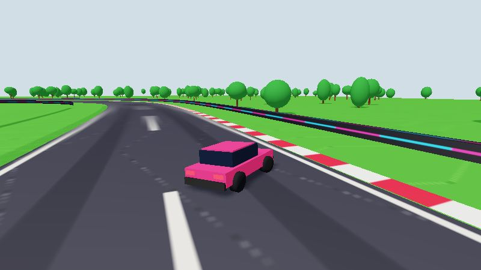
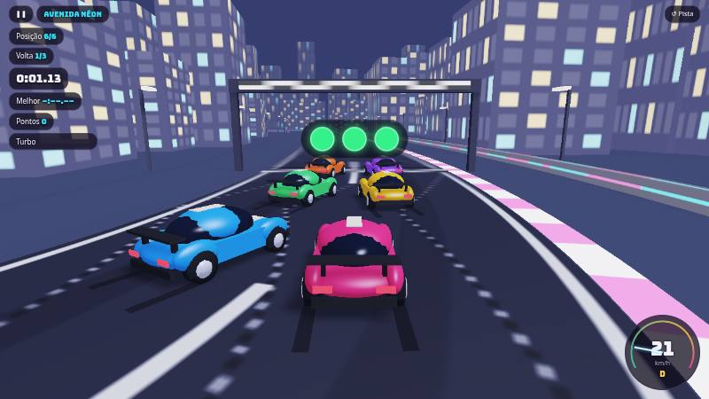
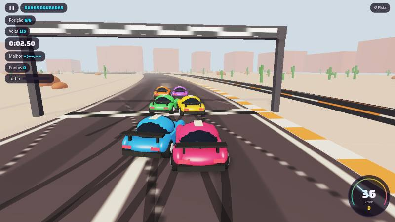
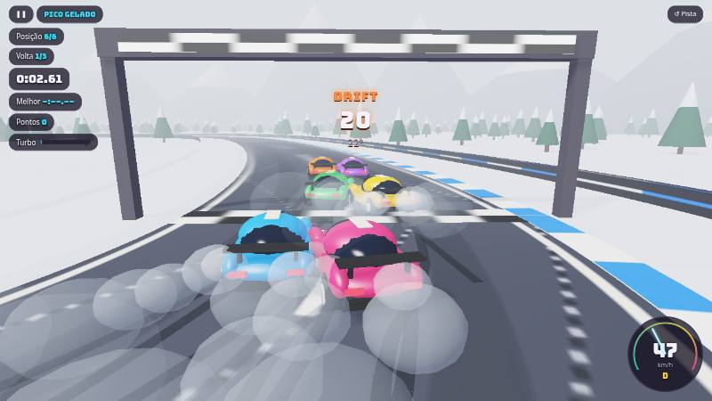
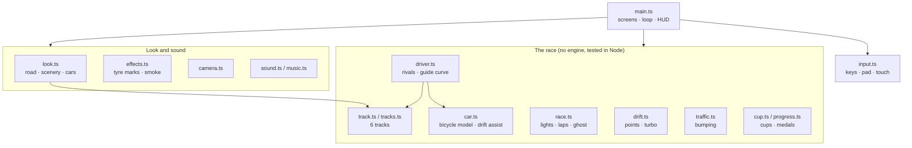

# Omega Drift

**Small, round toy cars on short tracks, where sliding well is what counts.**
A drift racer made with the Omega engine: controlled slides, a turbo charged by drifting,
ghosts and cups, with its own cars, tracks, look, sounds and music, all made in code.

**[▶ Play it](https://tugapse.github.io/omega-games/drift/)** · keyboard, gamepad or touch



| | |
| --- | --- |
| **Modes** | Campeonato (3 cups of 3 races), Corrida (3 laps against 5 rivals), Contra-relógio (against your ghost) |
| **Tracks** | 6 in 3 places (city, desert, snow), 755 to 1061 m, each also run backwards in the cups |
| **Cars** | Bolinha, Faísca, Trovão, Cometa, opened by medals |
| **Physics** | its own: a bicycle model at 1/120 s (no Rapier), so it is small and tested in Node |
| **Tests** | 113: the car, the drift assist, every track lapped both ways, races of six, the cups, the music |

<table>
<tr>
<td width="33%"><br><b>Avenida Néon</b>, in the city at night</td>
<td width="33%"><br><b>Dunas Douradas</b>, in the desert</td>
<td width="33%"><br><b>Pico Gelado</b>, in the snow</td>
</tr>
</table>

## Playing

Hold the **handbrake** in a bend and, with the drift assist on (the default), the car slides
round it on its own: steer into the bend to tighten it, let go to straighten out. Drifts earn
points, linked drifts multiply them up to **×5**, and they fill the **turbo**, which fires as
a drift ends.

| | Keyboard | Gamepad | Touch |
| --- | --- | --- | --- |
| Accelerate | ↑ / W | RT or A | by itself |
| Brake, reverse | ↓ / S | LT or X | drag down on the left, TRAVÃO |
| Steer | ← → / A D | stick or cross | drag sideways on the left |
| Handbrake (drift) | space | B or RB | DRIFT |
| Back on the road | R | | ↺ |
| Pause | Esc or P | Start | ❚❚ |

### Medals

Each track has two: one for the **best lap**, one for the **drift points** in a race
(L is the track's length in m).

| | 🥉 Bronze | 🥈 Silver | 🥇 Gold |
| --- | --- | --- | --- |
| Best lap faster than | L/22 s | L/26 s | L/30 s |
| Drift points over | L | 2L | 3.5L |
| Worth | 1 | 2 | 3 |

Of 36 in all: **Faísca** opens at 4, **Trovão** at 12, **Cometa** at 22. Everything is kept in the browser.

## How it is made



<details>
<summary><b>Every file in detail</b></summary>

- `src/car.ts`: the car at a fixed 1/120 s step, a bicycle model (a front and a rear axle). Each axle's tyres push sideways against their slip angle up to their grip (front 1.0, rear 1.1, rear with the handbrake 0.45, times the ground's grip); the rear tyres share their grip between the drive and the side force, so the throttle and the handbrake swing the tail out. Drive up to 11 kN and 120 kW, a soft limiter at 34 m/s, brakes 60/40, reverse with the brake held at a standstill, less lock at speed, a slide assist past 29°. The turbo: 30% more drive and top speed while it lasts.
- Drift assist (in `src/car.ts`): above 25 km/h the handbrake with the wheel turned a fifth of the way, the handbrake alone where the road bends, full lock held a quarter of a second, or a free slide past 12° starts an assisted drift. The game then holds the car sideways and carries it round at a set rate (0.5 rad/s with the wheel let go, up to 1.05 rad/s steering in, never past 2.4 g). With the guide (below) and the wheel let go it turns at the rate the road needs instead, slowing down when the bend is too tight, swinging across into the next bend of an S, and straightening out on a straight once the handbrake is let go. Steering out, braking, a hard knock or dropping under 25 km/h end it.
- `src/driver.ts`: the grip driver (pure pursuit on the centre line, speed from the bends ahead, traction control); `guideCurve`, the curvature from where the car goes to the road's line a little ahead, a little inside the bend, which the player's car is handed when the assist is on; and the rivals, who keep to their own line, move across to pass a car close ahead, and drift the bends with the guide like a player holding the handbrake, their pace capping their speed and their throttle in a slide.
- `src/track.ts`: a track is a closed Catmull-Rom curve through control points, sampled every metre, with a width: road, kerb, then grass, sand or snow (by the place), then a wall the car bounces off.
- `src/tracks.ts`: the six tracks (Avenida Néon and Porto à Noite in the city, Dunas Douradas and Canhão Vermelho in the desert, Pico Gelado and Vale Branco in the snow, 755 to 1061 m) and each reversed, for the cups.
- `src/themes.ts`: the three places: what is off the road (grass 0.6 grip, sand 0.55, snow 0.5, with drag), the sky, the light, the fog and the colours.
- `src/cars.ts`: the four cars (Bolinha, Faísca, Trovão, Cometa), each quicker than the one before in its own way.
- `src/race.ts`: the start lights (three reds 0.8 s apart, then green), laps counted through 8 checkpoints in order, lap times, the standings (finished by time, the rest by how far round); the ghost, recorded 30 times a second and replayed between samples.
- `src/drift.ts`: drift points (degrees × m/s ÷ 10 a second while sliding), the multiplier for linked drifts (within 1.5 s, up to ×5), banked after 1.5 s straight, lost on a wall hit over 3 m/s; the turbo charge (900 points with the multiplier, 1.5 s).
- `src/traffic.ts`: cars bumping: each car is two circles, overlapping cars are pushed apart and bounce, shared by mass.
- `src/cup.ts`: the three cups, their rivals (names, paces from easy to quick, cars), points by place (10, 8, 6, 5, 4, 3) and the table.
- `src/progress.ts`: best laps, drift points, medals, cup places and the chosen car, kept in the browser; what opens the cars and the cups.
- `src/camera.ts`: the chase camera, swinging round with a lag and looking along a blend of the nose and the motion, so a slide is seen from the side; wider with speed and the turbo.
- `src/input.ts`: keyboard, gamepad and touch merged into one input.
- `src/look.ts`: the track's road, kerbs, walls and the start gantry as strips along the curve (pieces far away hidden); each place's ground and scenery (buildings with lit windows and street lamps, cacti, rocks and mesas, pines and snowy mountains), sky, fog and light; the cars, round toy cars of our own with rims that steer and roll and a body that leans.
- `src/effects.ts`: tyre marks (a ring of 900 quads in one mesh, written straight into its vertex buffer) and smoke puffs.
- `src/sound.ts` and `src/music.ts`: the engine following the revs through five gears, the tyres squealing, the effects, and a tune for each place (a night drive in A minor, a plucked tune in D dorian, bells over pads in G major), all synthesised with Web Audio.
- `src/main.ts`: the screens, the fixed-step loop with the six cars, the HUD (position, lap, lap time, best, points, turbo, the speedometer, the drift meter, the start lights), the results, the cups, the drawing resolution stepping down on slow devices; `window.drift` exposes hooks for tests.

The tests check the car, the drift assist and the guided drift, every track (no bend tighter than 12 m, no part of it near another, lapped by the grip driver and by a player who only holds the handbrake, both ways round), every car on every track, a race of six on every track, the race, the score, the medals, the cups and the music.

</details>

### Page options

| Option | |
| --- | --- |
| `?track=<id>` | starts a race straight away (`avenida`, `porto`, `dunas`, `canhao`, `pico`, `vale`; add `-r` for reversed); `&mode=trial` for a time trial |
| `?auto` | a bot drives it |
| `?touch` | the touch controls on any screen |
| `?debug` | frame rate, drawing resolution, drift angle and the rear tyres' load |
| `?quality=low\|medium\|high` | forces a quality |

```sh
npm run build -- drift   # → docs/drift/
npx vitest run src/drift
```
