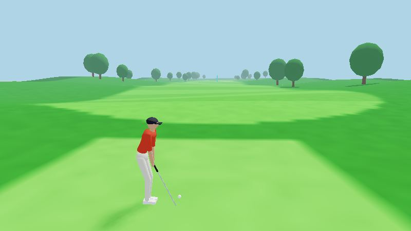
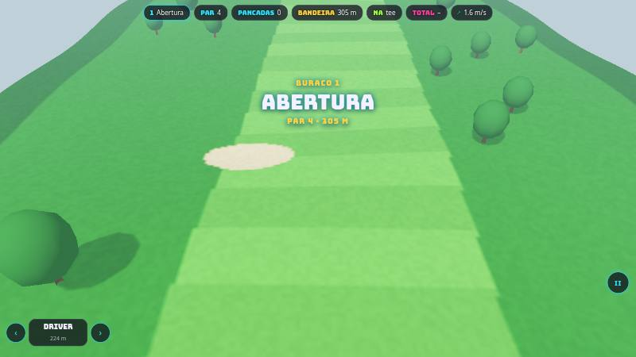
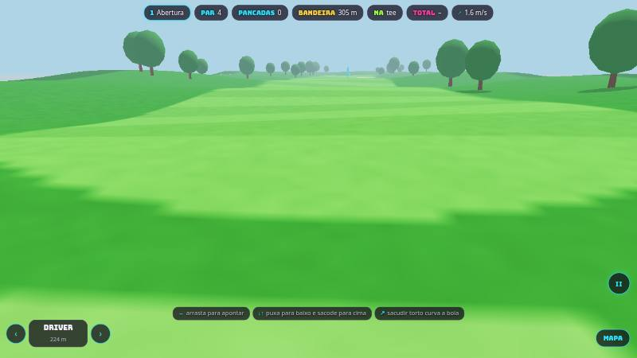
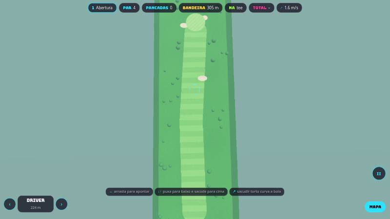
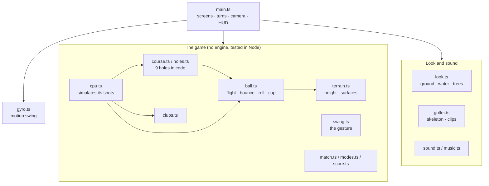

# Omega Golf

**Nine holes of Vale Omega, a swing you drag with a finger, and wind to read.**
A casual golf game made with the Omega engine, with its own course, look and golfer. The ball
has its own physics (no Rapier), so the game stays small and its tests run in Node.

**[▶ Play it](https://tugapse.github.io/omega-games/golf/)** · mouse, keyboard or touch



| | |
| --- | --- |
| **Course** | Vale Omega: 9 holes, par 36, with bunkers, lakes, creeks, an island green and wind |
| **Games** | 9 or 3 holes, Bandeira (nearest the pin), Treino (the range) |
| **Players** | one to four, and the computer (easy, medium, hard) |
| **Ball** | gravity, drag and Magnus lift and curve, bounces, rolling down slopes, the cup's lip |
| **Tests** | 45, one checks every green can be reached in regulation |

<table>
<tr>
<td width="33%"><br>The fly-in over each hole</td>
<td width="33%"><br>On the tee: club, wind, distance</td>
<td width="33%"><br>The map view (M)</td>
</tr>
</table>

## Playing

**Drag down** to take the club back (that is the power), then **turn back up** to hit: the swing
goes off as the finger turns, no need to let go. A flick within 14° of straight goes straight;
the curve grows past that. A sideways drag aims.

| | Mouse / touch | Keyboard |
| --- | --- | --- |
| Aim | drag sideways | ← → |
| Change club | ‹ › by the club | ↑ ↓ |
| Swing | drag down, turn up | hold space (or Enter), let go |
| Curve | the angle of the flick | Q / E while holding |
| Map | MAPA | M |
| Pause | ❚❚ | Esc or P |

### The clubs

| Club | Full shot from the fairway |
| --- | --- |
| Driver | about 224 m |
| Wood | about 190 m |
| Iron | about 150 m |
| Wedge | about 90 m (and less held back by sand) |
| Putter | a putt's power is the distance on a flat green, up to 20 m |

The rough and sand take speed off. On the green, dashes flow downhill (white, gold, pink as it steepens).

### The holes

| # | Hole | | # | Hole | | # | Hole |
| --- | --- | --- | --- | --- | --- | --- | --- |
| 1 | Abertura | | 4 | Duna | | 7 | Colina |
| 2 | Lago Azul | | 5 | Ribeiro | | 8 | Cotovelo |
| 3 | Pinhal | | 6 | Ilha | | 9 | Regresso |

## How it is made



<details>
<summary><b>Every file in detail</b></summary>

- `src/terrain.ts`: the ground: a height grid sampled bilinearly (height, normal, `downhill`) and a surface grid (tee, fairway, rough, sand, green, water, out), with how each surface plays (bounce, rolling resistance).
- `src/ball.ts`: the ball: flight with gravity, drag and the Magnus effect (backspin lifts, sidespin curves), wind, bounces (backspin bites), rolling down slopes (5/7 g), the cup (catches rolls under 1.5 m/s; a faster ball catches the lip once and turns away), water and out of bounds, trees (trunks bounce the ball back, leaves slow it); `simulate` plays a shot to the end without drawing.
- `src/clubs.ts`: driver, wood, iron, wedge, putter (full shots on the fairway: about 224, 190, 150 and 90 m; a putt's power is the distance on a flat green, up to 20 m); `shotFor` turns power and curve into a shot; `suggestClub` picks one for the distance; `lieFactor` takes speed off from the rough and sand (less for the wedge in sand).
- `src/course.ts`: holes described in code (tee, pin, fairway line and width, green radius and tilt, hills and a rise, bunkers, lakes and creeks, seeded trees, the strongest wind) and the ground built from them: bunker dishes, water beds under a level set just below their banks (the green and tee stay dry: an island green works), trees kept in the rough; `dropPoint` for a ball in water.
- `src/holes.ts`: the course, Vale Omega: nine holes, par 36 (Abertura, Lago Azul, Pinhal, Duna, Ribeiro, Ilha, Colina, Cotovelo, Regresso). A test checks every green can be reached in regulation without wind.
- `src/swing.ts`: the gesture: drag down to take the club back (power, on the bar; a quarter of the screen is full power), then turn back up to hit: the swing goes off as the finger turns up (no need to let go), a flick within 14° of straight goes straight and the curve grows gently past that; a sideways drag aims.
- `src/golfer.ts`: the golfer: the bowler's skeleton holding a club (shaft length per club), with Idle, Swing (top at 0.9 s, impact at 1.12 s) and Putt clips keyed in code; the backswing follows the power bar; the downswing runs on the game's clock and reaches the ball 0.15 s after the flick.
- `src/gyro.ts`: optional motion swing: hold a finger, swing the phone, let go; the peak rate is the power, a wrist twist curves. Hidden unless the page has `?gyro`.
- `src/match.ts`: a game for one to four players (the computer last): each plays a hole (or a challenge, or a ball) in turn, then all move on; scored in strokes (a hole ends at 10: pick-up), metres or points; totals, against par, ranking.
- `src/cpu.ts`: the computer (easy, medium, hard): tries clubs, powers and aims with the ball's own simulation (wind and trees included; the easy one ignores the wind), avoiding water, sand and rough; on the green it searches the putt that drops; then swings with errors by skill (over six holes of par 20 in the test: about 26, 23 and 22 strokes).
- `src/modes.ts`: the other games: nearest the pin (one shot at three greens: Lago Azul, Ilha and a 110 m approach on Abertura; metres left count, 30 m for water or out) and the range (10 balls at three targets 70, 130 and 190 m down Abertura's fairway; rings of 3, 8 and 15 m score 50, 25 and 10 points).
- `src/music.ts`: background music, a sunny tune of our own in D major (pluck arpeggios, pad, bass, bells, shaker), sequenced in code and scheduled ahead with plain Web Audio; softer in the pause menu.
- `src/sound.ts`: sounds synthesised with plain Web Audio (swing, strike by club, landing, leaves, trunk, splash, the cup, a chime, a miss); not the engine's AudioEngine, because of bugs G12 and G13.
- `src/score.ts`: names of a score on a hole (birdie, par, bogey…).
- `src/look.ts`: the golfer's meshes (cap, glove, club heads: wood, blade, putter); per hole, built the first time it is played: the terrain mesh and its painted surfaces, water surfaces, trees merged into two meshes (the engine has no instancing); shared: ball, flag and cup, the landing marker, sun and sky.
- `src/main.ts`: start-up, the start screen (game, players and names, computer), turns with a banner, the scorecard after each hole, pause (Esc, P, leaving the page), the end screen with the ranking and a record per device, states (intro fly-in, aim, swing, flight, result), HUD, camera, the trail, the green's slope (dashes flowing downhill: white, gold, pink as it steepens), the map view from above, the pole taken out for short putts. Keys: M map, arrows aim and change club, hold space (or Enter) for power and let go to hit, Q/E while holding curve left/right.

</details>

### Page options

| Option | |
| --- | --- |
| `?gyro` | the motion-swing button (hold, swing the phone, let go) |
| `?debug` | frame rate |
| `?quality=low\|medium\|high` | forces a quality |

```sh
npm run build -- golf   # → docs/golf/
npx vitest run src/golf
```
