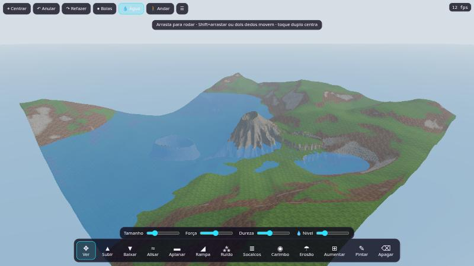
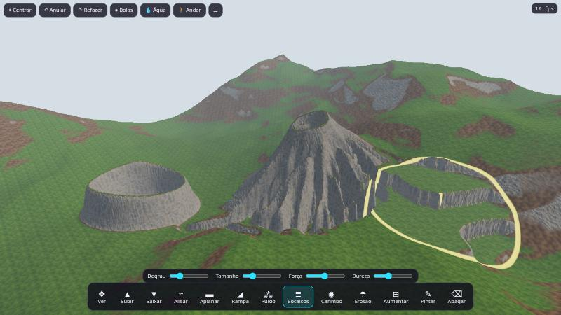
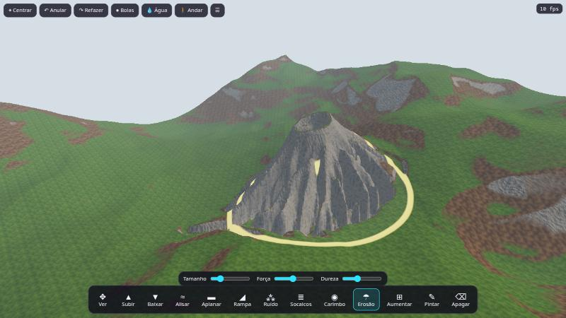
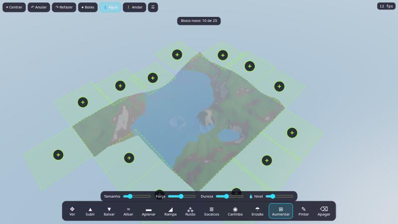
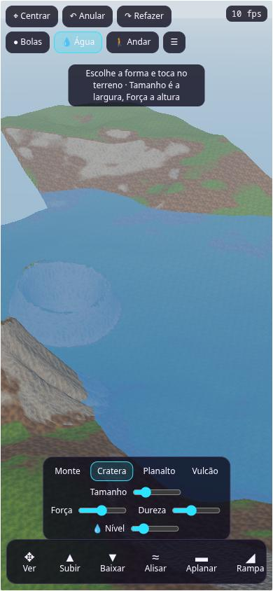
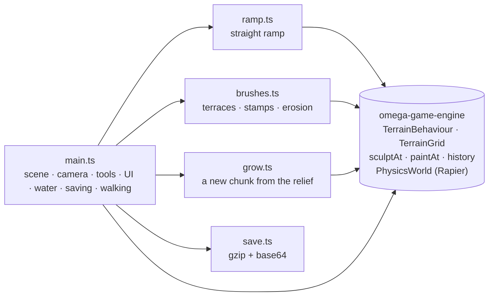

# Omega Terreno

**Sculpt, paint, flood and walk a terrain, in the browser, with a finger or the mouse.**
A demo of the Omega engine's terrain system: chunks of heightfield painted by height and slope
rules, Rapier colliders, undo, LOD, and a toolbox built on top of it.

**[▶ Play it](https://tugapse.github.io/omega-games/terrain/)** · works on phones



| | |
| --- | --- |
| **Terrain** | 3 × 3 chunks of 128 m to start (up to 25), 129 × 129 heights each, seeded relief |
| **Painting** | grass, dirt on slopes over 22°, rock over 33°, snow over 38 m; paint any layer over the rules |
| **Physics** | Rapier heightfield colliders, rebuilt after each stroke; balls to roll down it |
| **Saving** | by itself in the browser (gzipped, ~400 KB painted), or to a `.terreno` file |
| **Tests** | 15 (the ramp, the brushes, growing, saving), in Node |

## What you can do

<table>
<tr>
<td width="33%"><br><b>Rampa</b>: drag from A to B for a straight slope between their heights; the strip shows where it goes, with its length and grade.</td>
<td width="33%"><br><b>Carimbo</b> and <b>Socalcos</b>: a hill, crater, plateau or volcano in one tap; steps cut into a slope.</td>
<td width="33%"><br><b>Erosão</b>: drops of rain run downhill under the brush, cutting gullies and filling hollows.</td>
</tr>
<tr>
<td><br><b>Aumentar</b>: a + on every free side; a new chunk carries the relief on and bends to meet what you sculpted.</td>
<td><br><b>Andar</b>: on foot at eye height (WASD, a touch stick on phones); in the water you swim.</td>
<td><br>The same on a phone: one finger works the tool, two move the camera.</td>
</tr>
</table>

### The tools

| Tool | What it does | Settings |
| --- | --- | --- |
| ✥ **Ver** | turns the camera; double tap glides to a point | |
| ▲ **Subir** / ▼ **Baixar** | raises or lowers the ground where you drag | Tamanho, Força, Dureza |
| ≈ **Alisar** | smooths bumps | Tamanho, Força, Dureza |
| ▬ **Aplanar** | flattens to the height where the stroke began | Tamanho, Força, Dureza |
| ◢ **Rampa** | a straight slope from where you press to where you let go | Tamanho = width, Dureza = soft edges |
| ⁂ **Ruído** | roughens the ground with noise | Tamanho, Força, Dureza |
| ≣ **Socalcos** | pulls the slope into flat steps | **Degrau** (2–20 m) |
| ◉ **Carimbo** | Monte, Cratera, Planalto or Vulcão, in one tap | Tamanho = width, Força = height (up to 40 m) |
| ☂ **Erosão** | hydraulic erosion under the brush | Tamanho, Força, Dureza |
| ⊞ **Aumentar** | adds a chunk on a free side (not undone) | |
| ✎ **Pintar** / ⌫ **Apagar** | paints a layer over the rules, or fades the painting back to them | the layer, Tamanho, Força |

Every stroke, ramp and stamp is one step of **↶ Anular** / **↷ Refazer** (Ctrl+Z, Ctrl+Shift+Z).
**💧 Água** floods the terrain to a level you set; **● Bolas** drops five Rapier balls;
the **☰** menu saves, exports and opens files, bakes the rules into the painting, clears it
and makes a new relief.

### Moving around

| | Mouse and keyboard | Touch |
| --- | --- | --- |
| Turn | drag in Ver, or the right button with any tool; Q / E | one finger in Ver, or twist two fingers |
| Move | middle button or Shift+drag; WASD or the arrows | drag two fingers |
| Come closer | the wheel (towards the cursor) | pinch (towards the fingers) |
| Go to a point | double click in Ver | double tap in Ver |
| Back to the start | ⌖ Centrar | ⌖ Centrar |
| Walk (Andar) | drag to look, WASD, Shift runs, Esc leaves | left of the screen is a stick, the rest looks |

The camera never leaves the terrain.

## How it is made



The new brushes are written like the engine's own (`terrain-brush.ts`): in terrain space, on
the grid's global vertices, returning the vertices they changed, so they can move into the
engine as they are.

| File | |
| --- | --- |
| `src/main.ts` | the scene (sun, ambient light, fog), the `TerrainBehaviour` and its layers, the Rapier world, the orbit camera (grab to move, zoom to the cursor, keys, glide), picking the ground with `terrain.raycast`, the tools and the overlay (the ramp strip, the + markers, the touch stick), the water, saving, walking, on-screen errors with the GPU's name |
| `src/ramp.ts` | `ramp()` lays a straight slope between two points with soft edges; `rampAt()` does it from world points as one undo step |
| `src/brushes.ts` | `terrace()`, `stamp()` with its four profiles, and `erode()`: droplet erosion worked on a copy of the heights (about 2 ms for 20 drops) |
| `src/grow.ts` | `fillChunk()`: the relief over a new chunk, shifted near the borders it shares (inverse-distance from the shared vertices) so it meets sculpted ground exactly |
| `src/save.ts` | the saved world (chunks as the engine saves them, seed, water) gzipped with `CompressionStream`, and base64 |

### Page options

| Option | |
| --- | --- |
| `?quality=low\|medium\|high` | low turns off triplanar, halves the textures and draws far chunks coarser |
| `?seed=N` | another relief (and skips the saved terrain) |
| `?wateralpha=0.7` | how see-through the water is (1 is opaque) |
| `?debug` | shows the diagnostics line (GPU, shaders, GL errors) |

```sh
npm run build -- terrain   # → docs/terrain/
npx vitest run src/terrain
```
