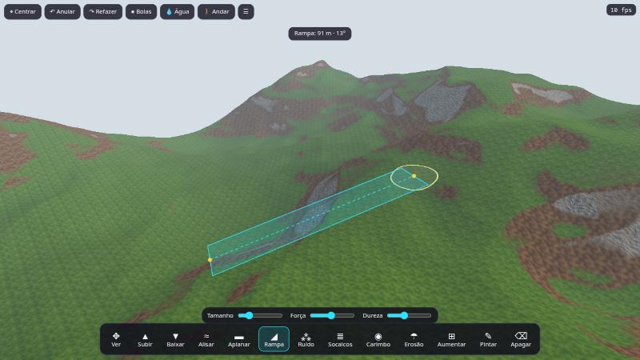
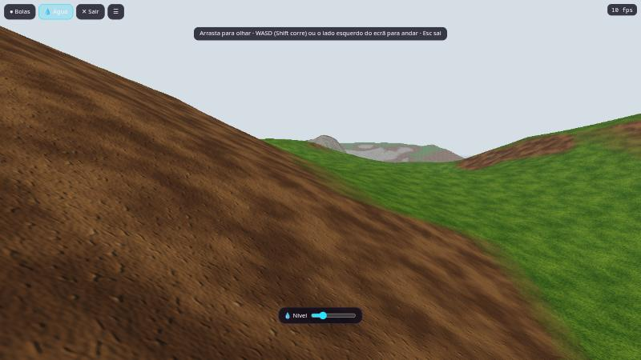
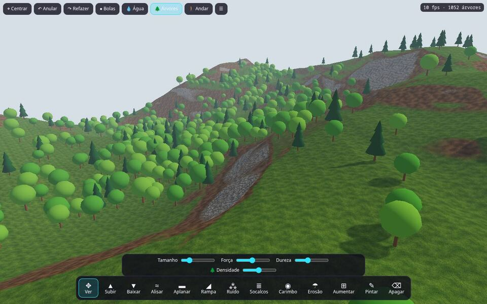
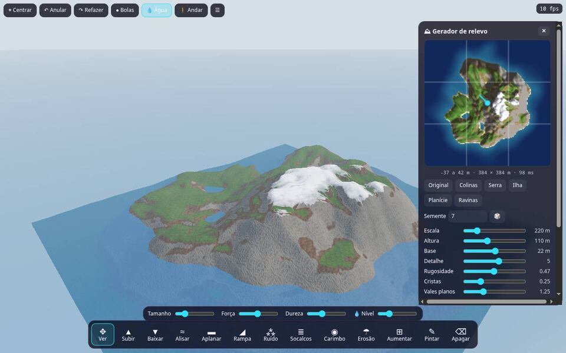
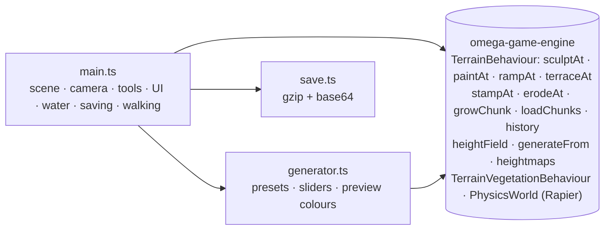

# Omega Terreno

**Sculpt, paint, flood and walk a terrain, in the browser, with a finger or the mouse.**
A demo of the Omega engine's terrain system: chunks of heightfield painted by height and slope
rules, Rapier colliders, undo, LOD, and a toolbox built on top of it.

**[▶ Play it](https://tugapse.github.io/omega-games/terrain/)** · works on phones


| | |
| --- | --- |
| **Terrain** | 3 × 3 chunks of 128 m to start (up to 25), 129 × 129 heights each, seeded relief |
| **Painting** | grass, dirt on slopes over 22°, rock over 33°, snow over 38 m; paint any layer over the rules |
| **Physics** | Rapier heightfield colliders, rebuilt after each stroke; balls to roll down it |
| **Saving** | by itself in the browser (gzipped, ~400 KB painted), or to a `.terreno` file |
| **Trees** | pines and broadleaves scattered by the rules or the painting, in woods and clearings; rebuilt where you sculpt |
| **Relief** | a generator with presets and nine numbers, live on the terrain; heightmaps in and out (PNG, .r16) |
| **Tests** | 5 here (the generator's panel, saving); the tools and trees are tested in the engine |

## What you can do

<table>
<tr>
<td width="33%"><br><b>Rampa</b>: drag from A to B for a straight slope between their heights; the strip shows where it goes, with its length and grade.</td>
<td width="33%"><br><b>Carimbo</b> and <b>Socalcos</b>: a hill, crater, plateau or volcano in one tap; steps cut into a slope.</td>
<td width="33%"><br><b>Erosão</b>: drops of rain run downhill under the brush, cutting gullies and filling hollows.</td>
</tr>
<tr>
<td><br><b>Aumentar</b>: a + on every free side; a new chunk carries the relief on and bends to meet what you sculpted.</td>
<td><br><b>Andar</b>: on foot at eye height (WASD, a touch stick on phones); in the water you swim.</td>
<td><br>The same on a phone: one finger works the tool, two move the camera.</td>
</tr>
</table>

### Trees



**🌲 Árvores** (on from the start) grows trees on every chunk, and **🌲 Densidade** sets how many
(the trees follow once the slider is let go). Where they grow:

| | |
| --- | --- |
| **The ground** | where the grass layer is, as the rules lay it: not where slopes turn to dirt (from 22°) or rock, not on the snow (from 38 m), not under the water or on its shore |
| **The painting** | the same, painted: none on painted dirt, rock or snow; painted grass grows them anywhere |
| **Woods** | a large noise makes woods and clearings, with a few trees out in the open |
| **Kinds** | broadleaves low down, more pines the higher it gets |

The same seed and numbers always give the same trees, and a lower density only takes some away.
After a stroke (or a new relief, a water level, a painting) only the chunks that changed are
built again, one a frame. On foot the trunks are solid. It is the engine's `TerrainVegetationBehaviour`:
each chunk's trees are four merged meshes (trunks, pines, two greens of crowns), which work with
its lights, shadows and fog until it has instancing.

### The relief generator



**☰ → ⛰ Gerador de relevo** (or **G**) opens a panel with a map of the relief from above. While a
slider moves, the map follows once the finger rests; with **Ver no terreno** on, the terrain
follows a moment after you let go. Everything the panel does until you close it, sculpt or press **✓ Feito** is one
undo step (painting made for the old relief is cleared first, so the rules paint the new one), and
**↺ Repor** takes it back.

| Number | What it changes |
| --- | --- |
| **Semente** 🎲 | which relief, for the same numbers |
| **Escala** | metres across the largest features |
| **Altura** / **Base** | how far from the lowest point to the highest, and where its middle sits |
| **Detalhe** | layers of smaller bumps on the big ones |
| **Rugosidade** | how much of each smaller layer is kept |
| **Cristas** | rolling hills (0) to sharp ridges (1) |
| **Vales planos** | flattens the valleys and lifts the peaks |
| **Torção** | bends the relief by more noise: winding valleys and ridges |
| **Ilha** | sinks the ground towards the edges, with a wobbly coast |

Presets to start from: **Original**, **Colinas**, **Serra**, **Ilha** (turns the water on),
**Planície**, **Ravinas**. A tap on the map takes the camera there; **Em cinzento** shows it as a
heightmap.

**Heightmaps:** **⤓ PNG** saves the terrain as it is (sculpting included) as a grey image, a pixel
per vertex, black −64 m and white 192 m; **⤓ .r16** saves it in 16 bits for other programs.
**Abrir imagem…** takes any grey image (or a square .r16) as the relief: it is stretched over the
terrain, an 8-bit image is smoothed so its greys don't show as steps, and Altura and Base set
what black and white mean (opening the demo's own PNG puts it back as it was). Torção and Ilha
work on an image too.

### The tools

| Tool | What it does | Settings |
| --- | --- | --- |
| ✥ **Ver** | turns the camera; double tap glides to a point | |
| ▲ **Subir** / ▼ **Baixar** | raises or lowers the ground where you drag | Tamanho, Força, Dureza |
| ≈ **Alisar** | smooths bumps | Tamanho, Força, Dureza |
| ▬ **Aplanar** | flattens to the height where the stroke began | Tamanho, Força, Dureza |
| ◢ **Rampa** | a straight slope from where you press to where you let go | Tamanho = width, Dureza = soft edges |
| ⁂ **Ruído** | roughens the ground with noise | Tamanho, Força, Dureza |
| ≣ **Socalcos** | pulls the slope into flat steps | **Degrau** (2–20 m) |
| ◉ **Carimbo** | Monte, Cratera, Planalto or Vulcão, in one tap | Tamanho = width, Força = height (up to 40 m) |
| ☂ **Erosão** | hydraulic erosion under the brush | Tamanho, Força, Dureza |
| ⊞ **Aumentar** | adds a chunk on a free side (not undone) | |
| ✎ **Pintar** / ⌫ **Apagar** | paints a layer over the rules, or fades the painting back to them | the layer, Tamanho, Força |

Every stroke, ramp and stamp is one step of **↶ Anular** / **↷ Refazer** (Ctrl+Z, Ctrl+Shift+Z).
**💧 Água** floods the terrain to a level you set; **🌲 Árvores** grows woods (below); **● Bolas** drops five Rapier balls;
the **☰** menu saves, exports and opens files, bakes the rules into the painting, clears it
opens the relief generator, and **⟲ Recomeçar do zero** (tapped twice) puts everything back as the
demo starts: 3 × 3 chunks of the original relief, no painting, water or balls, no undo.

### Moving around

| | Mouse and keyboard | Touch |
| --- | --- | --- |
| Turn | drag in Ver, or the right button with any tool; Q / E | one finger in Ver, or twist two fingers |
| Move | middle button or Shift+drag; WASD or the arrows | drag two fingers |
| Come closer | the wheel (towards the cursor) | pinch (towards the fingers) |
| Go to a point | double click in Ver | double tap in Ver |
| Back to the start | ⌖ Centrar | ⌖ Centrar |
| Walk (Andar) | drag to look, WASD, Shift runs, Esc leaves | left of the screen is a stick, the rest looks |

The camera never leaves the terrain.

## How it is made

The demo is mostly page: the terrain, its tools and its trees are the engine's (6.1.0). They
were built here first and moved into the engine once they worked.



| File | |
| --- | --- |
| `src/main.ts` | the scene (sun, ambient light, fog), the `TerrainBehaviour` and its layers, the `TerrainVegetationBehaviour` (the engine's pines and broadleaves on the grass layer), the Rapier world, the orbit camera (grab to move, zoom to the cursor, keys, glide), picking the ground with `terrain.raycast`, the tools (each one call to the terrain) and the overlay (the ramp strip, the + markers, the touch stick), the water, saving, walking (trunks solid with `vegetation.pushOut`), the generator's panel (live on the terrain as one undo step, PNG and .r16 in and out), on-screen errors with the GPU's name |
| `src/generator.ts` | the generator's numbers and presets, and `preview()`: a relief from above (the engine's `sampleField`), coloured like the rules with hill shading, or grey |
| `src/save.ts` | the saved world (chunks as the engine saves them, the relief's numbers, water, trees) gzipped with `CompressionStream`, and base64 |

### Page options

| Option | |
| --- | --- |
| `?quality=low\|medium\|high` | low turns off triplanar, halves the textures and draws far chunks coarser |
| `?seed=N` | another seed for the relief (and skips the saved terrain) |
| `?wateralpha=0.7` | how see-through the water is (1 is opaque) |
| `?debug` | shows the diagnostics line (GPU, shaders, GL errors) |

```sh
npm run build -- terrain   # → docs/terrain/
npx vitest run src/terrain
```
